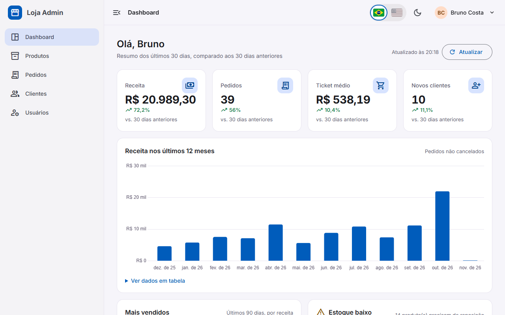

# Store Admin · Angular 20 e-commerce admin panel

[Português](README.md) · **English**

Admin panel for a fictitious online store, built with **Angular 20** (standalone components,
Signals, the new control flow, `rxResource`, functional guards/interceptors/resolvers) and
**Angular Material 3**. It has a mocked JWT login with two roles, a dashboard with KPIs and a revenue
chart, a product catalog with "server-side" pagination/sorting/filtering, orders with a timeline and
a status workflow, customers with their purchase history and user management. The whole API is
simulated in the browser with `angular-in-memory-web-api`, so the demo runs on GitHub Pages with no
backend. The UI is available in **Brazilian Portuguese and English**.

**Live demo:** https://brunoicosta.github.io/angular-ecommerce-admin/

| Account            | Password  | Role                                    |
| ------------------ | --------- | --------------------------------------- |
| `admin@loja.com`   | `demo123` | Administrator: full access              |
| `manager@loja.com` | `demo123` | Manager: cannot delete or see "Users"   |



## Highlights

- Mocked JWT auth, `authGuard`/`guestGuard`, and `roleGuard('admin')` as `canMatch` (managers never
  download the users chunk); the fake API enforces the same rules (401/403).
- Functional interceptors: auth header, global error handling with snackbars, signal-based loading
  bar.
- Dashboard (KPIs vs. previous 30 days, 12-month revenue chart deferred with `@defer`, best sellers,
  low-stock alert), products (Material table, bulk delete, reactive form with image preview,
  unsaved-changes guard), orders (status filter, timeline, state machine), customers, users.
- List state lives in the URL and reaches components through `withComponentInputBinding()`.
- Responsive shell with a collapsible sidenav, breadcrumb, light/dark theme, accessible states.
- Deterministic seed data (60 products, 90 customers, 200 orders) from a seeded PRNG.

## Internationalization

- [Transloco](https://jsverse.gitbook.io/transloco) with `@jsverse/transloco-locale` for dates,
  numbers and currency (Intl). Global files in `public/i18n/{pt-BR,en}.json` and one lazy scope per
  feature in `public/i18n/<feature>/<lang>.json`, loaded with the feature chunk.
- Initial language: saved choice > browser language (`pt*` → pt-BR, anything else → en) > pt-BR.
  Brazil/USA flag buttons (accessible radio group) switch it live, persist it and update
  `<html lang>`. Prices stay in BRL; only the formatting changes.
- To add a language: extend `LANGUAGES`/`LANGUAGE_LOCALES`, add the JSON files with the same keys
  (a parity test checks them) and add its name and flag to the switcher.

## Stack

Angular 20.3 · Angular Material 20.2 · TypeScript 5.9 · RxJS 7.8 · Transloco 8.4 · Chart.js 4.5 /
ng2-charts 9 · angular-in-memory-web-api 0.20 · Karma/Jasmine · ESLint (angular-eslint) · Prettier.

## Running locally

```bash
npm install
npm start            # http://localhost:4200
npm run lint
npm run test:ci      # headless Chrome
npm run build
npm run build:pages  # build with the GitHub Pages base href
```

See the Portuguese [README](README.md) for the architecture notes and the folder structure.

## Author

Bruno Vinicius Isaac Costa · https://github.com/BrunoICosta · [MIT](LICENSE) license.
