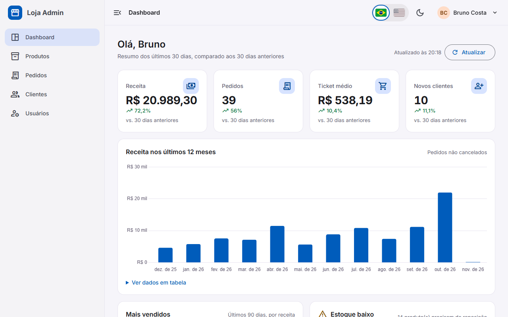

# Loja Admin · Painel de e-commerce em Angular 20

**Português** · [English](README.en.md)

Painel administrativo de uma loja virtual fictícia, feito com **Angular 20** (standalone, Signals,
novo control flow, `rxResource`, guards/interceptors/resolvers funcionais) e **Angular Material 3**.
Tem login com JWT simulado e dois perfis de acesso, dashboard com indicadores e gráfico de receita,
catálogo de produtos com paginação/ordenação/filtros "no servidor", pedidos com linha do tempo e
mudança de status, clientes com histórico de compras e gestão de usuários. Toda a API é simulada no
navegador com `angular-in-memory-web-api`, então a demo funciona como site estático, sem backend.

**Demo:** https://portfolio.brunoisaac.dev/angular-ecommerce-admin/

| Conta              | Senha     | Perfil                                   |
| ------------------ | --------- | ---------------------------------------- |
| `admin@loja.com`   | `demo123` | Administrador: acesso total              |
| `manager@loja.com` | `demo123` | Gerente: não exclui nem vê "Usuários"    |



## Funcionalidades

- **Autenticação** com JWT simulado (assinado pela API fake, com expiração de 8 h), sessão
  restaurada do `localStorage`, retorno à página de origem após o login e aviso de sessão expirada.
- **Perfis de acesso**: `authGuard`/`guestGuard` e `roleGuard('admin')` usado como `canMatch`
  (o chunk de "Usuários" nem é baixado por gerentes). A API também valida: `DELETE` e `/users`
  respondem 403 para gerentes.
- **Interceptors funcionais**: header `Authorization`, tratamento global de erros HTTP com snackbar
  (mensagens em pt-BR, logout automático no 401) e barra de carregamento baseada em um contador
  com Signals. Tokens de `HttpContext` permitem desligar o toast ou a barra por requisição.
- **Dashboard**: cards de KPI (receita, pedidos, ticket médio, novos clientes) comparando os
  últimos 30 dias com os 30 anteriores, gráfico de receita dos últimos 12 meses (Chart.js com
  `@defer (on viewport)` e tabela acessível dos dados), ranking de mais vendidos e alerta de
  estoque baixo.
- **Produtos**: tabela Material com paginação, ordenação, busca (sem acento) e filtros por
  categoria e situação de estoque, tudo refletido na URL; chips de status de estoque; seleção e
  exclusão em lote com diálogo de confirmação; formulário reativo tipado de criação/edição com
  validações, preview da imagem pela URL e aviso ao sair com alterações não salvas.
- **Pedidos**: lista com filtro por status (chips), busca e ordenação; detalhe com itens, totais,
  cliente e **linha do tempo**; mudança de status validada por uma máquina de estados
  (aguardando pagamento → pago → enviado → entregue, cancelamento antes do envio).
- **Clientes**: lista com totais por cliente (pedidos, total gasto, última compra) e detalhe com
  histórico de pedidos.
- **Usuários** (só admin): troca de perfil e ativação/desativação.
- **Layout**: shell responsivo com sidenav recolhível (trilho de ícones no desktop, gaveta no
  celular), breadcrumb gerado pelas rotas (inclusive com nomes resolvidos), tema claro/escuro
  persistido, link "pular para o conteúdo" e estados de carregamento, vazio e erro em todas as telas.
- **Dados realistas e determinísticos**: 60 produtos, 90 clientes e 200 pedidos gerados por um
  PRNG com semente fixa (mulberry32). As datas são relativas ao dia atual, então a demo sempre
  parece "de hoje", mas a mesma data de referência gera sempre os mesmos dados (testado).
- **Internacionalização pt-BR / English** com Transloco: escopos de tradução carregados sob demanda
  por feature, troca de idioma ao vivo por bandeiras no cabeçalho e no login, datas e números no
  formato do idioma (preços sempre em BRL), títulos das páginas, paginador, snackbars e mensagens de
  erro da API traduzidos.

## Stack

| Tecnologia                | Versão  |
| ------------------------- | ------- |
| Angular (core/CLI)        | 20.3    |
| Angular Material / CDK    | 20.2    |
| TypeScript                | 5.9     |
| RxJS                      | 7.8     |
| Chart.js / ng2-charts     | 4.5 / 9 |
| Transloco (+ Locale)      | 8.4     |
| angular-in-memory-web-api | 0.20    |
| Karma + Jasmine           | 6.4 / 5.9 |
| ESLint (angular-eslint)   | 9 / 20.7 |
| Prettier                  | 3.9     |

## Arquitetura e decisões

```
src/app/
  app.component.ts   app.config.ts   app.routes.ts
  core/        singletons: auth, interceptors, guards, layout (shell, breadcrumb), tema,
               notificações, modelos de domínio e a API fake
  shared/      componentes de UI reutilizáveis, pipes e utilitários (sem regra de negócio)
  features/<feature>/
    <feature>.routes.ts   rotas lazy da feature (exporta <FEATURE>_ROUTES)
    pages/                páginas roteadas (loadComponent)
    components/           componentes usados só pela feature
    data-access/          services HTTP e resolvers
    models/               modelos da feature
```

- **Lazy loading total.** `app.routes.ts` só declara o shell e faz `loadChildren` para cada feature
  (`auth`, `dashboard`, `products`, `orders`, `customers`, `users`, `errors`); dentro de cada
  `<feature>.routes.ts` toda página usa `loadComponent`. Os services de cada feature e o
  registro do Chart.js ficam nos `providers` da rota, então viajam junto com o chunk. O build de
  produção gera chunks separados, por exemplo: `dashboard-page-component`,
  `revenue-chart-component` (+ um chunk de ~220 kB do Chart.js carregado só quando o gráfico entra
  na tela), `product-list-page-component`, `product-form-page-component`,
  `order-list-page-component`, `order-detail-page-component`, `customer-list-page-component`,
  `customer-detail-page-component`, `user-list-page-component`, `login-page-component` e os
  `*-routes` de cada feature. As traduções seguem a mesma lógica: só o arquivo global vai no início e
  cada feature baixa o próprio escopo (`i18n/<feature>/<idioma>.json`) junto com o chunk. O bundle
  inicial fica em ~654 kB (≈171 kB transferidos).
- **A URL é o estado das listas.** Página, tamanho, ordenação, busca e filtros vivem na query
  string e chegam aos componentes como `input()` via `withComponentInputBinding()`. Um `computed`
  monta a consulta e um `rxResource` busca os dados; links, F5 e o botão voltar simplesmente
  funcionam. `linkedSignal` mantém a página anterior visível enquanto a próxima carrega.
- **Zoneless + Signals.** `provideZonelessChangeDetection()`, todos os componentes `OnPush`,
  estado local com `signal`/`computed`/`linkedSignal`, `input()`/`output()`, control flow nativo
  e `@let`. Nada de `NgModule`, `CommonModule`, `ngClass` ou `@HostBinding`.
- **API fake que se comporta como uma de verdade.** Um `InMemoryDbService` intercepta só o que
  precisa de regra (paginação, agregados do dashboard, login, autorização, validação de status) e
  deixa o CRUD simples com a biblioteca. Um `HttpBackend` próprio converte as falhas da biblioteca
  em `HttpErrorResponse`, para que interceptors e telas não saibam que o backend é falso. A API
  tem latência simulada de 350 ms para os estados de carregamento aparecerem.
- **Regras puras e testadas.** Geração de dados, consulta/paginação, agregados do dashboard, JWT,
  máquina de estados dos pedidos e linha do tempo são funções puras com testes unitários.
- **Tema** com `mat.theme` (Material 3) usando `theme-type: color-scheme`: os tokens usam
  `light-dark()`, então alternar o tema é só trocar o `color-scheme` da raiz.
- **Acessibilidade**: labels e `aria-*` em todos os controles, foco visível, `aria-current` na
  navegação e no breadcrumb, chips com ícone + texto (nunca só cor), cores do gráfico validadas
  para contraste e tabela alternativa dos dados do gráfico.

> Como os dados ficam em memória, qualquer alteração (criar, excluir, mudar status) dura até a
> página ser recarregada.

## Internacionalização

- **Biblioteca:** [Transloco](https://jsverse.gitbook.io/transloco) (`@jsverse/transloco`) com
  `@jsverse/transloco-locale` para datas, números e moeda via `Intl`.
- **Arquivos:** `public/i18n/pt-BR.json` e `public/i18n/en.json` (textos globais: menu, títulos,
  status, categorias, erros) e um escopo por feature em `public/i18n/<feature>/<idioma>.json`
  (`auth`, `dashboard`, `products`, `orders`, `customers`, `users`). Cada rota de feature declara
  `provideTranslocoScope('<feature>')`, então o escopo é carregado junto com o chunk lazy.
- **Idioma inicial:** escolha salva no `localStorage` > idioma do navegador (`pt*` → pt-BR, qualquer
  outro → en) > pt-BR. A troca é feita pelas bandeiras (grupo de rádio acessível, setas do teclado
  funcionam), é persistida e atualiza o `<html lang>`.
- **Formatação:** `translocoCurrency`, `translocoDate` e `translocoDecimal` nos templates; nos
  `computed()` o `LanguageService` expõe `locale()` e `t()` reativos. Os preços continuam em BRL nos
  dois idiomas, só o formato muda (`R$ 1.479,90` / `R$1,479.90`).
- **Dados da API:** status, perfis, formas de pagamento e categorias chegam como códigos e são
  traduzidos na interface; erros da API trazem um `code` (ex.: `duplicate_sku`) traduzido em
  `apiErrors.*`. Nomes de produtos e clientes ficam como a API devolve.
- **Testes:** `provideI18nTesting(lang)` carrega os arquivos reais no `TranslocoTestingModule`, e um
  teste garante que todos os pares pt-BR/en têm as mesmas chaves.

**Como adicionar um idioma (ex.: espanhol):**

1. Inclua `'es'` em `LANGUAGES` e o locale em `LANGUAGE_LOCALES` (`src/app/core/i18n/i18n.model.ts`),
   e ajuste `detectLanguage` se quiser detectá-lo pelo navegador.
2. Crie `public/i18n/es.json` e `public/i18n/<feature>/es.json` com as mesmas chaves do pt-BR (o
   teste de paridade aponta o que faltar).
3. Adicione o nome (`LANGUAGE_NAMES`) e a bandeira (`FlagIconComponent`) no seletor de idioma.

## Como rodar

Pré-requisitos: Node 22 e npm 10.

```bash
npm install
npm start            # http://localhost:4200
npm run lint         # ESLint (TypeScript + templates, regras de acessibilidade)
npm run test:ci      # testes unitários no Chrome headless (Karma/Jasmine)
npm run build        # build de produção em dist/
npm run build:cf     # build de produção com base-href /angular-ecommerce-admin/
```

## Estrutura de pastas

```
src/app/
├── core/
│   ├── auth/            AuthService, JWT simulado, authGuard, roleGuard, authInterceptor
│   ├── fake-backend/    API em memória, consulta/paginação, agregados do dashboard, seed
│   ├── guards/          pendingChangesGuard
│   ├── http/            error/loading interceptors, LoadingService, tokens de contexto
│   ├── i18n/            Transloco, LanguageService, seletor de idioma com bandeiras, títulos
│   ├── layout/          shell (sidenav + toolbar) e breadcrumb
│   ├── models/          produto, pedido, cliente, usuário, página, dashboard
│   ├── notifications/   NotificationService (snackbar)
│   └── theme/           ThemeService (claro/escuro)
├── shared/
│   ├── components/      page-header, stat-tile, status-chip, order-status-chip,
│   │                    error-state, confirm-dialog
│   ├── i18n/            paginador traduzido
│   └── utils/           http params, estado de lista na URL, resource
└── features/
    ├── auth/            login
    ├── dashboard/       KPIs, gráfico de receita, mais vendidos, estoque baixo
    ├── products/        lista, formulário, chips de estoque, preview de imagem
    ├── orders/          lista, detalhe, linha do tempo
    ├── customers/       lista e detalhe
    ├── users/           gestão de usuários (admin)
    └── errors/          acesso negado e página não encontrada
```

## CI

`.github/workflows/ci.yml`: em push/PR na `main`, roda `npm ci`, lint, testes (Chrome headless) e
build.

## Deploy

Publicado na Cloudflare (Workers static assets) em
https://portfolio.brunoisaac.dev/angular-ecommerce-admin/ pelo pipeline do repositório
[portfolio](https://github.com/BrunoICosta/portfolio), que roda `npm run build:cf` e serve
`dist/angular-ecommerce-admin/browser` (o fallback de SPA para rotas profundas fica no Worker).

## Próximos passos

- Trocar a API em memória por um backend real (NestJS ou .NET) mantendo os mesmos contratos.
- Persistir alterações da demo em `IndexedDB`.
- Exportação de pedidos em CSV e filtros por período.
- Testes end-to-end com Playwright.
- Internacionalização (`@angular/localize`) para inglês.

## Autor

Bruno Vinicius Isaac Costa · https://github.com/BrunoICosta

Licença [MIT](LICENSE).
